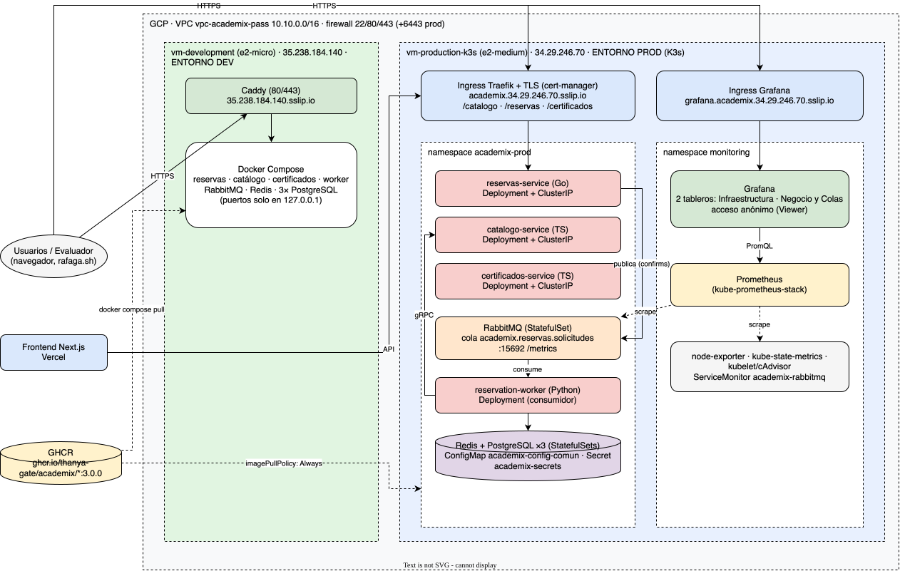

# Práctica 10: orquestación en K3s, observabilidad y exposición de servicios

**Academix Pass & CertiHub · Software Avanzado · Segundo Semestre 2026**

## Índice

1. [Introducción](#1-introducción)
2. [Arquitectura desplegada](#2-arquitectura-desplegada)
3. [Despliegue completo en K3s (Prod)](#3-despliegue-completo-en-k3s-prod)
4. [Stack de observabilidad](#4-stack-de-observabilidad)
5. [Doble entorno operativo](#5-doble-entorno-operativo)
6. [Prueba de absorción de colas bajo carga](#6-prueba-de-absorción-de-colas-bajo-carga)
7. [Incidencias resueltas](#7-incidencias-resueltas)
8. [Infraestructura como código (Terraform + Ansible)](#8-infraestructura-como-código-terraform--ansible)
9. [Conclusiones](#9-conclusiones)

## Accesos rápidos

| Entorno | URL |
|---|---|
| **Prod** (K3s, Ingress) | `https://academix.34.123.206.113.sslip.io/{catalogo,reservas,certificados}/...` |
| **Grafana** (público, solo lectura) | <https://grafana.academix.34.123.206.113.sslip.io> |
| **Dev** (VM + Docker Compose) | `https://35.238.184.140.sslip.io/{catalogo,reservas,certificados}/...` |
| Frontend | <https://sa-practica7.vercel.app> |

Endpoints de salud: `/reservas/api/salud`, `/catalogo/api/talleres/salud` y `/certificados/api/certificados/salud`.

---

## 1. Introducción

En esta práctica la plataforma SOA llega a producción sobre el clúster **K3s**
creado en la Práctica 9 con Terraform y Ansible. Los servicios de negocio
(Talleres/Catálogo, Reservas/Ticketing y Certificados), el broker RabbitMQ y los
workers consumidores corren como recursos de Kubernetes. El tráfico perimetral
entra por un **Ingress Controller (Traefik) con TLS**, y un stack **Prometheus +
Grafana** da visibilidad en tiempo real de los recursos del clúster y de las colas.
En paralelo, la VM de desarrollo ejecuta la misma versión con **Docker Compose**,
así que los dos entornos coexisten en la nube.

## 2. Arquitectura desplegada



Archivo crudo: [`docs/arquitectura-k3s.drawio`](docs/arquitectura-k3s.drawio).

Flujo de una reserva:

1. El cliente hace `POST /reservas/api/reservas` al Ingress.
2. `reservas-service` (Go) valida la petición, publica el evento en RabbitMQ con
   *publisher confirms* y responde `202 Accepted` con un `trackingId`.
3. `reservation-worker` (Python) consume la cola, consulta el cupo por gRPC a
   `catalogo-service` y persiste la reserva.

Prometheus extrae las métricas del broker y del clúster, y Grafana las muestra.

## 3. Despliegue completo en K3s (Prod)

Manifiestos en [`deploy/kubernetes/`](deploy/kubernetes/README.md), orquestados con Kustomize.

| Requisito | Implementación |
|---|---|
| Deployments con límites de CPU y memoria | `catalogo-service`, `reservas-service`, `certificados-service` y `reservation-worker`. Todos con `requests`/`limits`. |
| Broker y datos | RabbitMQ, Redis y 3× PostgreSQL como StatefulSets con PVC (`local-path`). |
| Services `ClusterIP` | Comunicación interna HTTP y gRPC entre servicios y el broker. |
| Ingress | Traefik con TLS de Let's Encrypt (cert-manager); rutas `/catalogo`, `/reservas` y `/certificados` con *strip-prefix* y redirección a HTTPS. |
| ConfigMaps y Secrets | `academix-config-comun` (TZ, CORS) y `academix-secrets` (credenciales, creado fuera de git). |
| Container Registry | Imágenes `ghcr.io/thanya-gate/academix/*:4.0.0` con `imagePullPolicy: Always`. En K3s no se ejecuta `docker build`. |

```bash
export KUBECONFIG=Practica9/infra/ansible/kubeconfig/k3s.yaml
kubectl apply -k Practica10/deploy/kubernetes
```

## 4. Stack de observabilidad

Detalle e instalación en [`deploy/observability/`](deploy/observability/README.md).

- **Prometheus** (`kube-prometheus-stack`, Helm) extrae métricas de:
  - `kubelet`/cAdvisor: CPU, memoria y red de cada pod.
  - `kube-state-metrics`: fase de los pods y estado de los nodos.
  - `node-exporter`: recursos del nodo.
  - **RabbitMQ**, mediante el plugin `rabbitmq_prometheus` y el `ServiceMonitor academix-rabbitmq`: mensajes encolados y tasas de publicación y consumo
- **Grafana** se expone por Ingress con TLS y **acceso anónimo de solo lectura**. La contraseña de admin está en un Secret, no en git.

| Tablero | Paneles |
|---|---|
| **Academix · Infraestructura** | CPU de pods, memoria de pods, nodos K3s listos, pods por fase, tráfico de red. |
| **Academix · Negocio y Colas** | Longitud de cola, mensajes listos/sin acuse, tasa de publicación, tasa de consumo (ack), tickets procesados. |

Los dashboards se versionan como ConfigMaps con la etiqueta `grafana_dashboard: "1"`,
y el sidecar de Grafana los importa solo.

## 5. Doble entorno operativo

| | Dev | Prod |
|---|---|---|
| VM | `vm-development` (e2-micro) | `vm-production-k3s` (e2-medium) |
| Orquestación | Docker Compose | K3s |
| Exposición | Caddy (80/443) con TLS automático | Ingress Traefik + cert-manager |
| Imágenes | GHCR `:4.0.0` (`docker compose pull`) | GHCR `:4.0.0` (`imagePullPolicy: Always`) |
| Puertos internos | Ligados a `127.0.0.1`; solo Caddy es público | `ClusterIP` |

El entorno Dev reutiliza el entregable `Practica7/docker-compose.yml`, que no tiene
`build:`. Se despliega con:

```bash
Practica10/deploy/dev/deploy-dev.sh          # tag por defecto 4.0.0
```

El script copia el compose, los SQL de inicialización y `Caddyfile.dev` a
`/opt/academix-dev`, genera un `.env` con credenciales aleatorias (solo la primera
vez) y ejecuta `docker compose pull && up -d`.

## 6. Prueba de absorción de colas bajo carga

```bash
Practica10/loadtest/rafaga.sh                                   # Prod: 500 reservas, 50 concurrentes
Practica10/loadtest/rafaga.sh https://35.238.184.140.sslip.io 100 10   # Dev
```

El script toma un `eventoId` real del catálogo y lanza las peticiones con
`xargs -P` y `curl`, sin dependencias extra. Los correos son únicos y usan el
dominio de demostración `demo.test`, que acepta el backend. Al terminar resume
los códigos HTTP.

**Resultado medido en Prod** (13/10/2026, 500 peticiones a concurrencia 50):

| Medida | Valor |
|---|---|
| Respuestas del Ingress | **500 × 202 Accepted**, 0 errores, 25 s |
| Pico de la cola (`sum(rabbitmq_queue_messages)`) | **378 mensajes** |
| Tasa de publicación máxima | ~19 msg/s |
| Tasa de consumo del worker | ~7 msg/s sostenida |
| Cola vacía de nuevo | ~80 s después de la ráfaga |
| Reinicios de pods durante la prueba | 0 |

En el tablero *Negocio y Colas* se ve la curva completa: la cola sube mientras la
publicación supera al consumo y baja cuando el worker la vacía. El Ingress nunca
deja de responder `202`, porque la petición solo espera la confirmación del
broker y no el procesamiento. Para vaciar la cola más rápido basta con escalar
el consumidor:

```bash
kubectl scale deploy/reservation-worker -n academix-prod --replicas=3
```

## 7. Incidencias resueltas

| Problema | Causa | Solución |
|---|---|---|
| Grafana no estaba desplegado y su Ingress era inválido | `port.number: service` y Service `prometheus-grafana` inexistente | Puerto `80` y Service `kube-prometheus-stack-grafana`. |
| El tablero de colas salía vacío | Filtraba por la etiqueta `queue`, que `rabbitmq_prometheus` no expone en sus métricas agregadas | Consultas con `sum(...)` sobre las métricas agregadas. |
| RabbitMQ en Prod se reiniciaba en bucle y las reservas devolvían 422 | La liveness probe `rabbitmq-diagnostics ping` arranca una VM Erlang; con el límite de 500m de CPU en la e2-medium superaba el timeout y Kubernetes mataba un broker sano. `reservas-service` no se reconecta solo | Liveness por TCP, readiness con timeout de 20 s y límite de CPU de 1 core. Reinicio de `reservas-service` y del worker. |
| RabbitMQ tardaba en arrancar en Dev | La e2-micro tiene poca CPU y el healthcheck fallaba en el primer arranque | `deploy-dev.sh` reintenta `docker compose up -d` una vez. |

> **Riesgo conocido:** `reservas-service` abre la conexión AMQP una sola vez y no
> se reconecta si el broker se reinicia (ver `rabbitmq_broker.go`). Si RabbitMQ se
> reinicia, hay que ejecutar `kubectl rollout restart deploy/reservas-service -n academix-prod`.
> La solución definitiva es añadir reconexión en el código y publicar una imagen nueva.

## 8. Infraestructura como código (Terraform + Ansible)

La red (VPC, subred, firewall), las dos VMs y su configuración (Docker en Dev, K3s
en Prod) se crean con Terraform y Ansible. La documentación, los diagramas y la
matriz de decisiones están en [`Practica9/README.md`](../Practica9/README.md).

```bash
cd Practica9/infra/terraform && terraform apply
cd ../ansible && ansible-playbook site.yml
```

### Reconstrucción completa en un comando

Si las VMs se recrean (`terraform destroy` + `apply` y `ansible-playbook site.yml` de la P9),
toda la Práctica 10 se vuelve a montar con:

```bash
Practica10/deploy/rebuild.sh            # TAG=4.0.0 Practica10/deploy/rebuild.sh para otra versión
```

El script es idempotente y tarda unos 2 minutos sobre un entorno existente:
1. Lee las IPs públicas actuales con gcloud y las sustituye en una copia temporal de los manifiestos.
2. Instala cert-manager y el ClusterIssuer.
3. Crea los Secrets si no existen (con credenciales aleatorias) y los ConfigMaps de SQL.
4. Aplica las apps en K3s, instala Prometheus y Grafana con Helm y despliega el entorno Dev.
5. Verifica los 7 endpoints públicos.

Si las IPs cambiaron, al final avisa de qué hay que actualizar (la URL de la API en Vercel).

## 9. Conclusiones

- La plataforma corre en K3s con Deployments acotados en recursos, Services internos,
  Ingress con TLS y configuración desacoplada en ConfigMaps y Secrets. Las imágenes
  vienen siempre del registry.
- La observabilidad mostró su valor desde el primer día: los dashboards y las métricas
  de Prometheus permitieron detectar que el broker de producción se reiniciaba por
  probes demasiado costosas, algo que el endpoint de salud del servicio no reflejaba.
- La arquitectura asíncrona absorbe ráfagas: con 500 peticiones concurrentes el
  Ingress respondió todas con `202` mientras la cola actuaba como amortiguador y el
  worker la vaciaba a su ritmo.
- Dev y Prod usan las mismas imágenes de GHCR con orquestadores distintos. Así se
  valida en Dev exactamente lo que después corre en Prod.
