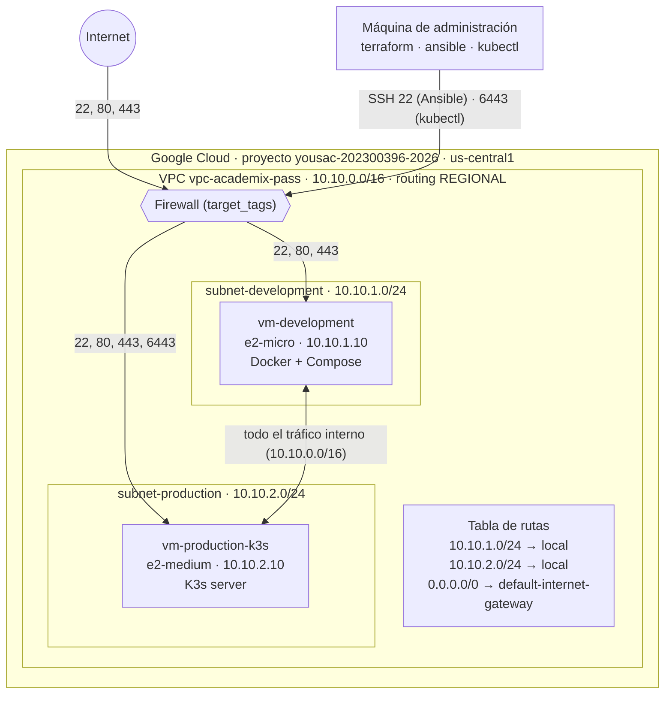
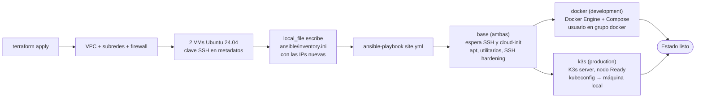

# Práctica 9 — Infraestructura como Código y Gestión de Configuración

**Academix Pass & CertiHub · Software Avanzado · Segundo Semestre 2026**

## Índice

1. [Introducción](#1-introducción)
2. [Estructura de la carpeta](#2-estructura-de-la-carpeta)
3. [Arquitectura de red en la nube](#3-arquitectura-de-red-en-la-nube)
4. [Flujo de aprovisionamiento](#4-flujo-de-aprovisionamiento)
5. [Terraform](#5-terraform)
6. [Ansible](#6-ansible)
7. [Prueba de reconstrucción total](#7-prueba-de-reconstrucción-total)
8. [Matriz de decisiones técnicas](#8-matriz-de-decisiones-técnicas)
9. [Seguridad](#9-seguridad)
10. [Conclusiones](#10-conclusiones)

---

## 1. Introducción

En las fases anteriores la infraestructura se creó desde la consola web de Google Cloud. Ese método no tiene control de versiones, no se puede repetir y produce *configuration drift*: cada servidor termina configurado de forma un poco distinta. En esta fase:

- **Terraform** declara la red, el firewall y las dos VMs en archivos `.tf` versionados.
- **Ansible** instala y configura el software de esas VMs de forma idempotente. Instala Docker y Docker Compose en desarrollo y K3s en producción.

El objetivo verificable es que tres comandos destruyan y reconstruyan todo el entorno sin entrar a la consola web.

## 2. Estructura de la carpeta

```
Practica9/
├── README.md                      # este documento
├── docs/
│   ├── arquitectura-red.drawio     # diagrama de red (archivo crudo)
│   └── flujo-aprovisionamiento.drawio
└── infra/
    ├── terraform/
    │   ├── versions.tf             # versión de Terraform y proveedores (google, local)
    │   ├── providers.tf            # proveedor google (credenciales por ADC, nunca en el código)
    │   ├── variables.tf            # todas las entradas, con valores por defecto
    │   ├── main.tf                 # VPC, subredes y las 2 VMs
    │   ├── firewall.tf             # reglas de firewall
    │   ├── outputs.tf              # IPs públicas, comandos SSH, resumen de puertos
    │   ├── ansible.tf              # genera ../ansible/inventory.ini
    │   ├── templates/inventory.ini.tftpl
    │   └── terraform.tfvars.example
    └── ansible/
        ├── ansible.cfg
        ├── site.yml                # punto de entrada: base → docker → k3s
        ├── inventory.ini           # GENERADO por Terraform (no versionado)
        ├── inventory.ini.example
        ├── group_vars/all.yml
        ├── playbooks/{base,docker,k3s}.yml
        ├── roles/{base,docker,k3s}/
        └── kubeconfig/             # aquí queda k3s.yaml (no versionado)
```

## 3. Arquitectura de red en la nube



**Tabla de rutas.** GCP crea automáticamente una ruta local por cada subred y una ruta por defecto `0.0.0.0/0` hacia el *default internet gateway*. Las VMs salen a internet con su IP pública efímera, que está en `access_config`.

**Puertos abiertos** (también los imprime `terraform output open_ports_summary`):

| Regla | Prioridad | Dirección | Puertos | Origen | Aplica a |
|---|---|---|---|---|---|
| fw-allow-ssh | 1000 | IN | 22/tcp | 0.0.0.0/0 | ambas VMs |
| fw-allow-http | 1010 | IN | 80/tcp | 0.0.0.0/0 | ambas VMs |
| fw-allow-https | 1020 | IN | 443/tcp | 0.0.0.0/0 | ambas VMs |
| fw-allow-k3s-api | 1030 | IN | 6443/tcp | 0.0.0.0/0 | solo producción |
| fw-allow-k3s-telemetry | 1040 | IN | 2379-2380, 4443, 10250, 30000-32767/tcp · 8472, 10250, 30000-32767/udp | 10.10.0.0/16 | solo producción |
| fw-allow-internal-vpc | 1050 | IN | todos | 10.10.0.0/16 | ambas VMs |
| fw-allow-health-checks | 1060 | IN | tcp | 130.211.0.0/22, 35.191.0.0/16 | ambas VMs |
| fw-allow-egress | 1000 | OUT | todos | destino 0.0.0.0/0 | ambas VMs |

## 4. Flujo de aprovisionamiento



La pieza que une las dos herramientas es `infra/terraform/ansible.tf`. Las IPs públicas cambian con cada `destroy`/`apply`, así que el inventario no se escribe a mano: Terraform lo genera con los valores reales al terminar el `apply`.

## 5. Terraform

### Requisitos

- Terraform ≥ 1.5 y la CLI `gcloud` autenticada con `gcloud auth application-default login`.
- Un par de claves SSH: `ssh-keygen -t ed25519 -f ~/.ssh/academix_pass_ed25519 -N ""`.

### Uso

```bash
cd Practica9/infra/terraform
terraform init
terraform apply -auto-approve
terraform output development_public_ip
terraform output production_public_ip
```

### Decisiones relevantes

- **IPs internas estáticas** (10.10.1.10 y 10.10.2.10). Así las reglas y la configuración de K3s (`--node-ip`) son estables.
- **Firewall por `target_tags`, nunca por IP.** Las reglas sobreviven a la recreación de las VMs.
- **`ssh_public_key_paths` es una lista.** Cada integrante agrega su `.pub` y todos quedan autorizados en ambas VMs.
- **`deletion_protection = false` y `auto_delete = true`.** Sin esto, la prueba de `destroy` no puede borrar las VMs ni sus discos.
- **Sin credenciales en el código.** El proveedor usa *Application Default Credentials*. El `.tfstate`, los `.tfvars` y los JSON de cuentas de servicio están en el `.gitignore`.

## 6. Ansible

### Uso

```bash
cd Practica9/infra/ansible
ansible-playbook -i inventory.ini site.yml
KUBECONFIG=kubeconfig/k3s.yaml kubectl get nodes
```

### Roles

| Rol | Hosts | Qué hace |
|---|---|---|
| `base` | todos | Espera a que la VM acepte SSH (`wait_for_connection`) y a que termine `cloud-init`. Luego hace `apt update` (el `upgrade` completo es opcional con `-e base_apt_upgrade=true`, porque en la e2-micro tarda más de 30 min), instala `git`, `curl`, `htop`, `net-tools` y `fail2ban`, y endurece SSH con un drop-in `00-hardening.conf` (sin root, sin contraseña, `MaxAuthTries 3`). El handler valida con `sshd -t` antes de reiniciar. |
| `docker` | development | Agrega el repositorio oficial de Docker (clave en `/etc/apt/keyrings`, formato deb822) e instala `docker-ce`, `containerd`, `buildx` y `docker-compose-plugin`. Agrega los usuarios al grupo `docker`, reconecta y verifica `docker compose version` sin `sudo`. |
| `k3s` | production | Escribe `/etc/rancher/k3s/config.yaml` (`node-name` corto, porque el FQDN de GCP supera los 63 caracteres que admite una etiqueta de Kubernetes; `tls-san` con la IP pública y `node-ip` interna) e instala K3s con versión fija en modo `server`. Espera el puerto 6443 y el nodo `Ready`, y copia el kubeconfig a la máquina local reemplazando `127.0.0.1` por la IP pública. |

### Idempotencia

Ejecutar `site.yml` dos veces seguidas deja la segunda corrida con `changed=0`. Para lograrlo:

- **Módulos declarativos.** Se usan `apt`, `user`, `template`, `service` y `deb822_repository`, que describen un estado deseado y solo actúan si el estado real difiere.
- **Instalador de K3s.** Es la única tarea con `command`, y usa `creates: /usr/local/bin/k3s`, así que no se reinstala si el binario ya existe.
- **Kubeconfig.** Se lee con `slurp` y se escribe con `copy`, que solo reporta cambio si el contenido es distinto.
- **Comandos de verificación.** Llevan `changed_when: false`.

### Detalles para la reconstrucción

- `ansible.cfg` desactiva `known_hosts`, porque tras un `destroy` GCP puede reasignar la misma IP con otra *host key*. También fuerza `IdentitiesOnly`, para que el agente SSH no gaste los 3 intentos de `MaxAuthTries` con otras claves.

## 7. Prueba de reconstrucción total

```bash
cd Practica9/infra/terraform
terraform destroy -auto-approve
terraform apply -auto-approve          # también regenera ../ansible/inventory.ini
cd ../ansible
ansible-playbook -i inventory.ini site.yml
KUBECONFIG=kubeconfig/k3s.yaml kubectl get nodes
ssh -i ~/.ssh/academix_pass_ed25519 ubuntu@$(cd ../terraform && terraform output -raw development_public_ip) docker compose version
```

**Ensayo realizado (06/10/2026):** destroy 1,5 min → apply 1 min (14 recursos) → Ansible 5 min, 0 fallos → nodo `Ready` desde la máquina de administración.

## 8. Matriz de decisiones técnicas

### ¿Por qué Terraform frente a CloudFormation o scripts manuales?

| Criterio | Terraform | AWS CloudFormation | Scripts manuales (`gcloud`/bash) |
|---|---|---|---|
| Soporte de GCP | Nativo (proveedor `google`) | ❌ Solo AWS | ✅ |
| Modelo | Declarativo: estado deseado | Declarativo | Imperativo: pasos |
| Estado y detección de drift | `tfstate` + `plan` muestra diferencias | Stacks + drift detection | ❌ No existe |
| Idempotencia | Sí, por diseño | Sí | Solo si se programa a mano |
| Vista previa de cambios | `terraform plan` | Change sets | ❌ |
| Destrucción ordenada | `terraform destroy` (grafo de dependencias) | Delete stack | Hay que escribir el orden inverso |
| Multi-nube / portabilidad | ✅ | ❌ | Parcial |
| Importar recursos existentes | Bloques `import {}` | Limitado | N/A |

**Decisión:** Terraform. CloudFormation no aplica, porque el proyecto vive en GCP. Los scripts no ofrecen estado, `plan` ni `destroy` confiables, que son justo lo que evalúa la prueba de reconstrucción.

### ¿Por qué Ansible frente a Dockerfiles en el SO base?

| Criterio | Ansible | Dockerfiles sobre el SO base |
|---|---|---|
| Qué configura | El **sistema operativo del host**: paquetes, `sshd`, usuarios, servicios systemd | El **interior de un contenedor** |
| Instalar Docker o K3s en el host | ✅ Es su caso de uso | ❌ Un contenedor no puede instalar el motor que lo ejecuta ni un servicio systemd del host |
| Securizar SSH del host | ✅ | ❌ |
| Agentes en las VMs | Ninguno (solo SSH + Python) | Requiere Docker ya instalado |
| Idempotencia | Módulos declarativos, `changed=0` en la 2.ª corrida | Cada `build` produce una imagen nueva |
| Varios hosts con roles distintos | Inventario + grupos (`development`, `production`) | ❌ |
| Integración con Terraform | Inventario generado por `local_file` | N/A |

**Decisión:** Ansible configura el host. Los Dockerfiles se siguen usando, pero para lo que sirven: empaquetar los servicios de negocio que luego corren sobre ese Docker o K3s. Las dos herramientas son complementarias.

## 9. Seguridad

- **Archivos fuera del repositorio:** `*.tfstate`, `*.tfvars`, `inventory.ini`, `kubeconfig/` y las claves privadas.
- **Autenticación SSH:** solo con clave pública. La contraseña y el login de root están deshabilitados, y `fail2ban` está activo.
- **Puertos internos de K3s** (etcd, kubelet, flannel): solo se aceptan desde la VPC.
- **Limitación conocida:** 22 y 6443 están abiertos a `0.0.0.0/0` para que el evaluador pueda conectarse durante la demostración. En producción real se restringirían a la IP del administrador o a Identity-Aware Proxy (`35.235.240.0/20`). Ver `terraform.tfvars.example`.

## 10. Conclusiones

- La infraestructura completa (red, firewall y cómputo) está descrita en código versionado y revisable mediante Pull Requests. Ya no depende de clics en la consola.
- Generar el inventario de Ansible desde Terraform elimina el único paso manual entre aprovisionar y configurar. Eso hace posible la reconstrucción desatendida con tres comandos.
- La idempotencia de los playbooks permite volver a ejecutarlos en cualquier momento para corregir el drift, sin riesgo de romper lo que ya está bien.
- Terraform y Ansible no compiten: Terraform crea los recursos de la nube (el *qué existe*), Ansible configura su sistema operativo (el *cómo está configurado*) y los contenedores empaquetan las aplicaciones.
